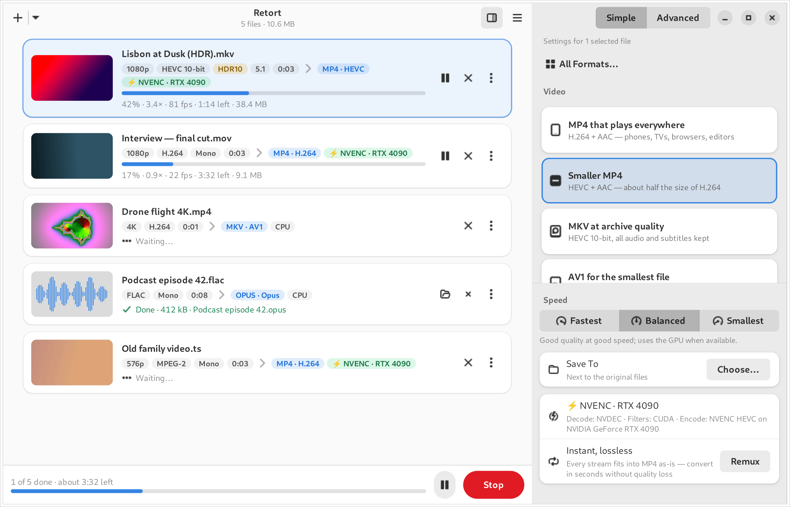
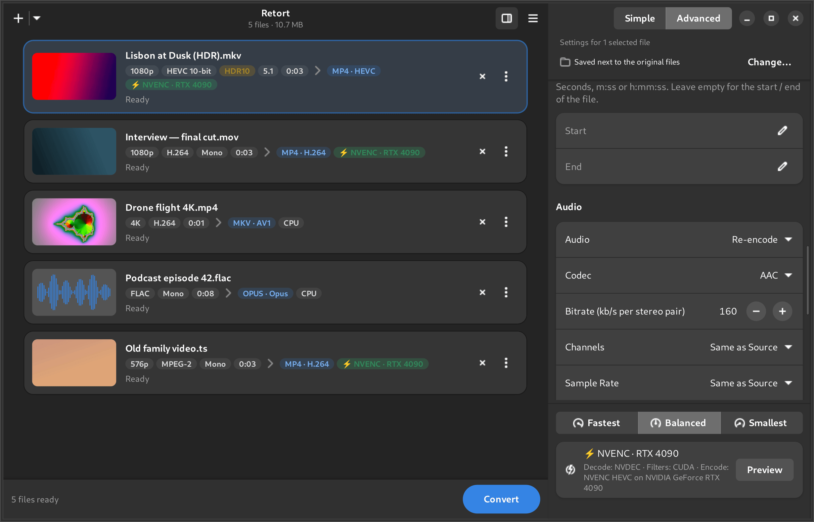
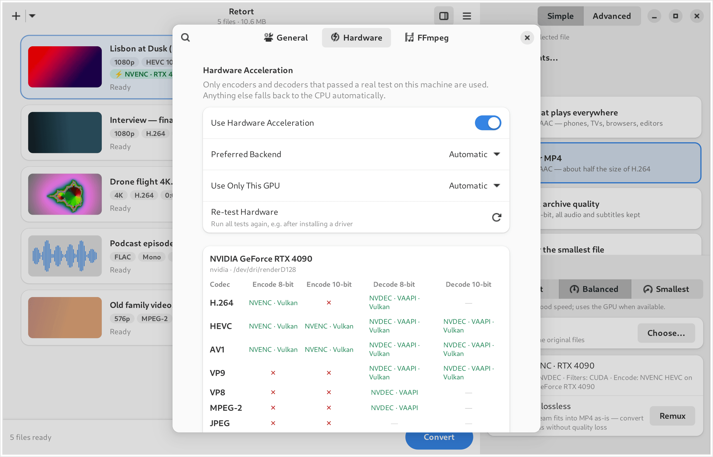
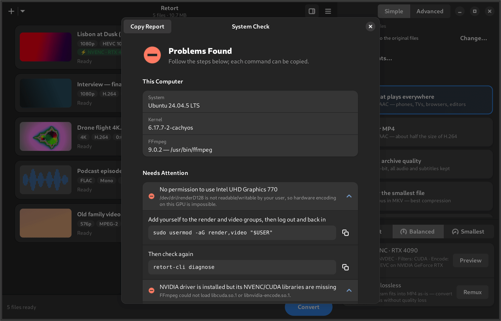
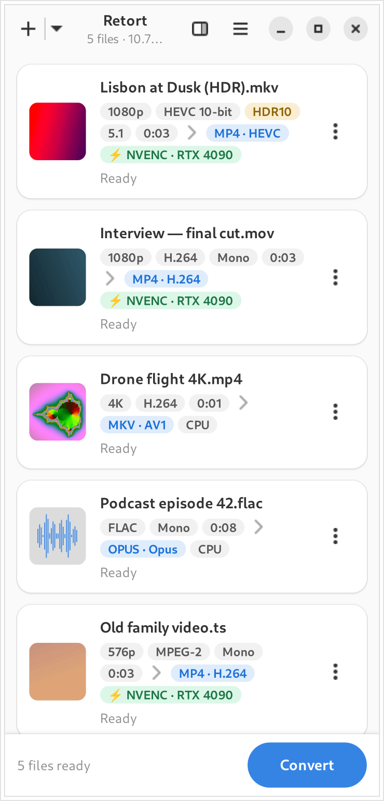

<div align="center">


# Retort

**Convert video and audio files with FFmpeg — fast where your hardware really can, correct everywhere.**



</div>

Retort is a converter for Linux (x86-64 and arm64) built with GTK 4 and
libadwaita. Drop in any audio or video file FFmpeg can read and turn it into
any format FFmpeg can write — with presets for the everyday cases and an
advanced mode that exposes almost everything.

- **Simple presets**: MP4 that plays everywhere, Smaller MP4 (HEVC), MKV at
  archive quality, AV1 for the smallest file, WebM for the web, *Fit under
  N MB* for Discord or email, Apple-friendly, ProRes/DNxHR editing
  intermediates, GIF and animated WebP, MP3/AAC/Opus/FLAC/WAV/ALAC, extract
  audio, and lossless remux.
- **Hardware acceleration you can trust**: NVENC/NVDEC, VA-API, Intel Quick
  Sync, Vulkan Video, AMD AMF and V4L2 M2M are used only where a *real* test
  encode and decode passed on your computer — per GPU, per codec, per bit
  depth. If a hardware job fails anyway, Retort retries on another GPU and
  then on the CPU automatically, and tells you why.
- **HDR done right**: HDR10, HLG and Dolby Vision are detected; HDR is kept
  when the target can carry it and tone-mapped to SDR otherwise (on the GPU
  with libplacebo or VA-API when possible).
- **Advanced mode**: encoder (Automatic or a specific, pinned one), rate
  control, presets and profiles, bit depth, GOP, scaling, frame rate,
  crop (with auto-detection), trim, rotate/flip, deinterlace, denoise,
  sharpen; audio codec, bitrate, channels, sample rate, EBU R128 loudness
  normalisation, track selection and default tracks; subtitles kept,
  converted, burned in or removed; metadata and chapters.
- **Preview**: encode 10 seconds from the middle and see the estimated final
  size and time before committing.
- **Transparent**: the exact FFmpeg command for every job is one click away
  and copyable; the log of every run is kept.
- **System Check** explains what works on your machine and gives the exact,
  distro-specific commands to fix what doesn't (drivers, permissions, FFmpeg
  builds without the right encoders).
- **Safe**: inputs are never modified; outputs are written to a temporary
  file and only renamed when FFmpeg succeeded; existing files are never
  overwritten unless you choose to.
- **Private**: no telemetry. The only network access is an optional, off by
  default update check in the AppImage and tarball builds.

| | |
|---|---|
|  |  |
|  |  |

## Install

Retort builds a normal package on your machine from this repository and
installs it with your package manager, which also pulls in FFmpeg. Run these
as your normal user (not root).

**Ubuntu 24.04 or newer:**

<!-- doc-test: same-as=debian -->
```bash
sudo apt install git build-essential debhelper meson ninja-build pkg-config gettext appstream desktop-file-utils libgtk-4-dev libadwaita-1-dev cargo-1.97
git clone https://github.com/oreo1298/FreeMediaConverter.git
cd FreeMediaConverter
./build-package.sh
```

**Arch Linux:**

<!-- doc-test: same-as=arch -->
```bash
sudo pacman -S --needed base-devel git
git clone https://github.com/oreo1298/FreeMediaConverter.git
cd FreeMediaConverter
makepkg -si
```

To update, run `git pull` in the `FreeMediaConverter` folder and build again
(`./build-package.sh`, or `makepkg -sif` on Arch).

[**docs/INSTALL.md**](docs/INSTALL.md) has the steps for Debian 13, Fedora,
AlmaLinux/RHEL 10 and openSUSE, full FFmpeg builds and GPU drivers, and the
ways that need no build: Flatpak, AppImage and a portable tarball from the
[Releases page](https://github.com/oreo1298/FreeMediaConverter/releases), plus
a Nix flake, a Gentoo ebuild and a Void template. Every command there is
tested in a fresh container of each distribution.

## Command line

`retort-cli` uses the same engine without GTK, so it also works on servers:

<!-- doc-test: context=cli -->
```bash
retort-cli diagnose
```

<!-- doc-test: context=cli -->
```bash
retort-cli convert holiday.mkv --preset mp4-compatible
```

<!-- doc-test: context=cli -->
```bash
retort-cli convert lecture.mp4 --preset target-size --size-mb 25 --preview
```

`retort-cli presets`, `retort-cli list-formats` and `retort-cli convert --help`
list everything; `--dry-run` prints the FFmpeg commands without running them.

## Build from source

You need Rust 1.92 or newer, Meson, GTK 4.14+, libadwaita 1.5+ and FFmpeg
(6.1 or newer):

<!-- doc-test: context=dev -->
```bash
meson setup _build --prefix=/usr/local
```

<!-- doc-test: context=dev -->
```bash
meson compile -C _build
```

<!-- doc-test: context=dev -->
```bash
sudo meson install -C _build --no-rebuild
```

See [CONTRIBUTING.md](CONTRIBUTING.md) for the development workflow and
[docs/TESTING.md](docs/TESTING.md) for how Retort is tested (including on
hardware it has never seen).

## Help wanted: hardware reports

Retort's hardware support is tested against simulated machines built from
real reports. If you have a GPU — especially an unusual one — please run
`scripts/collect-hw-report.sh` and attach the result to an issue. It takes a
minute and contains no personal files.

## License

GPL-3.0-or-later. FFmpeg is a separate program that Retort runs; the bundled
FFmpeg in the Flatpak and AppImage is a GPL build without non-free components.
